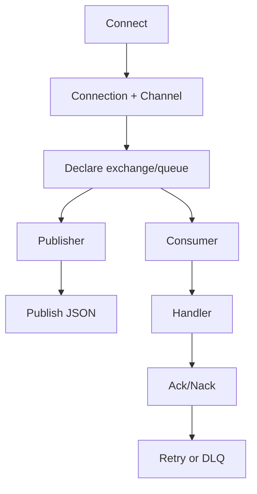

# Messaging RabbitMQ - Documentacion de fase 1

Esta documentacion cubre solo lo que existe dentro de `messaging/rabbit` al momento de esta fase. No intenta explicar integraciones externas ni adaptar el modulo a consumidores concretos.

## Proposito

Runtime RabbitMQ para publicar y consumir mensajes JSON con soporte opcional de DLQ y retries.

## Procesos principales

1. Conectar a RabbitMQ y abrir un canal reutilizable.
2. Declarar exchanges, queues, bindings y QoS/prefetch segun configuracion.
3. Publicar mensajes serializados a JSON con prioridad y contexto.
4. Consumir mensajes, ejecutar handlers y hacer ack o nack segun resultado.
5. Aplicar retries con headers y backoff, o mover mensajes a DLQ cuando se supera el maximo o cuando
   el error es permanente.

## Arquitectura local

- `Connection` encapsula conexion, canal y operaciones topologicas.
- `Publisher` y `Consumer` desacoplan publishing del loop de consumo.
- `DLQConfig` define una politica de reintentos simple sin scheduler externo.

## Cola muerta (`ConsumeWithDLQ`)

Cuando el handler devuelve un error, el consumidor decide entre tres salidas:

- **Reintento**: espera el backoff y republica el mensaje en su cola con `x-retry-count` subido.
- **Cola muerta por `max_retries`**: el fallo llega con los reintentos agotados.
- **Cola muerta por `permanent`**: `ConsumerConfig.IsPermanent(err)` devuelve `true`; no hay reintentos.
  El criterio lo pone el consumidor, no la libreria. Con `IsPermanent` en `nil` todo error se reintenta.
  Con el contexto cancelado el mensaje vuelve a la cola en vez de morir.

Sin cola muerta habilitada (`DLQ.Enabled` en `false`) el mensaje vuelve a la cola con `Nack` y el
clasificador no se consulta.

El mensaje muerto se publica **persistente** y conserva el cuerpo intacto. Sus cabeceras:

| Cabecera | Contenido |
| --- | --- |
| `x-retry-count` | Reintentos hechos antes de morir (0 si murio en la primera entrega). |
| `x-dead-reason` | `permanent` o `max_retries`. |
| `x-error` | Texto del ultimo error del handler, acotado a 1024 bytes (termina en `...[truncated]` si hubo corte). |
| `x-failed-at` | Instante Unix (UTC) en que se dio por muerto. |
| `x-first-exchange`, `x-first-routing-key` | Exchange y clave por los que el mensaje entro la primera vez. |
| `x-original-exchange`, `x-original-routing-key` | Los de la ultima entrega: tras un reintento, exchange vacio y el nombre de la cola. |

Ganchos opcionales de `ConsumerConfig`, pensados para que el consumidor escriba su log:

- `OnRetry(FailureEvent)`: se llama antes de la espera de cada reintento, con `Backoff`.
- `OnDeadLetter(FailureEvent)`: se llama cuando el mensaje quedo publicado en la cola muerta, con `Reason`.

`FailureEvent` lleva cola, reintento, maximo, error completo, tamano y hash corto (SHA-256) del cuerpo.

Dentro del handler, `DeliveryFromContext(ctx)` devuelve `DeliveryInfo`: cola, reintento (0 en la primera
entrega), maximo e `IsLastAttempt()`, que es cierto cuando un fallo de esa ejecucion agota los reintentos.

## Superficie tecnica relevante

- `Config`, `ExchangeConfig`, `QueueConfig`, `ConsumerConfig` y `DLQConfig` modelan la topologia y politicas.
- `Connect` crea la conexion base.
- `NewPublisher` y `NewConsumer` exponen publishing y consuming.
- `HandleWithUnmarshal` y `UnmarshalMessage` ayudan en handlers JSON.
- `FailureEvent`, `DeliveryInfo`, `DeliveryFromContext` y las constantes `Header*` y `DeadReason*`
  describen el fallo de un mensaje y su paso a la cola muerta.

## Dependencias observadas

- Runtime interno: ninguna dependencia interna en produccion.
- Tests internos: `testing` para Docker/Testcontainers.
- Runtime externo: `github.com/rabbitmq/amqp091-go`.

## Operacion actual

- `make build`, `make test`, `make test-race` y `make check` cubren el modulo.
- `make test-all` ejecuta integracion con RabbitMQ real usando Docker.
- Los tests `//go:build integration` (incluidos los de `ConsumeWithDLQ`) solo los corre
  `GOWORK=off make test-integration` desde la raiz del repo.

## Observaciones actuales

- El modulo cubre tanto happy path como reintentos y DLQ.
- La salud de la conexion se valida mediante un exchange temporal para evitar race conditions.
- Tiene tests unitarios e integracion bastante amplios.

## Limites de esta fase

- Las topologias concretas por servicio o dominio quedan para la fase 2.
- No documenta aun integraciones con el archivo externo `ecosistema.md`.
- No redefine politicas de release por modulo; eso queda para la fase 3.
